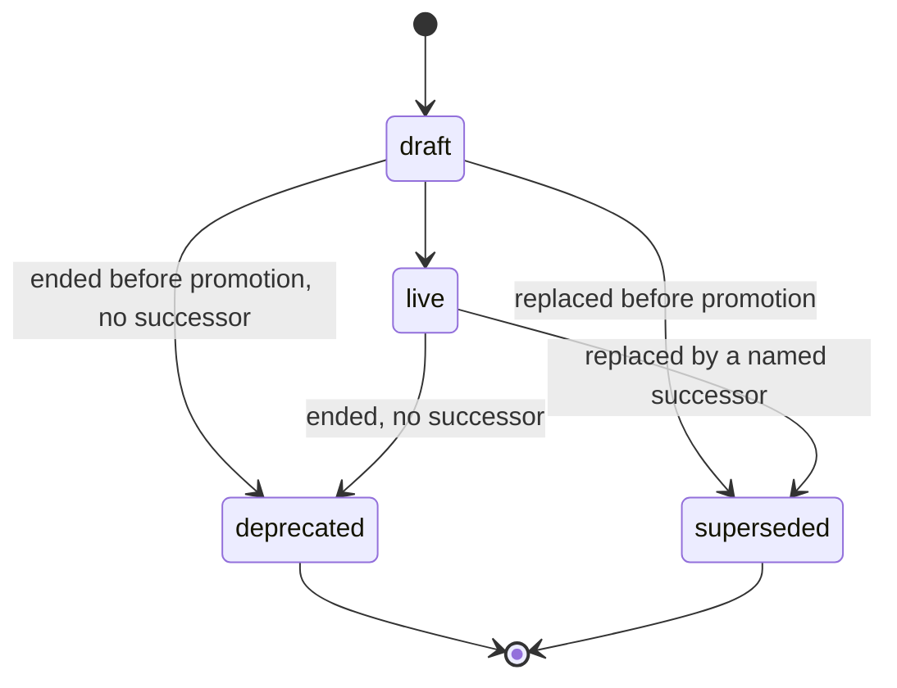
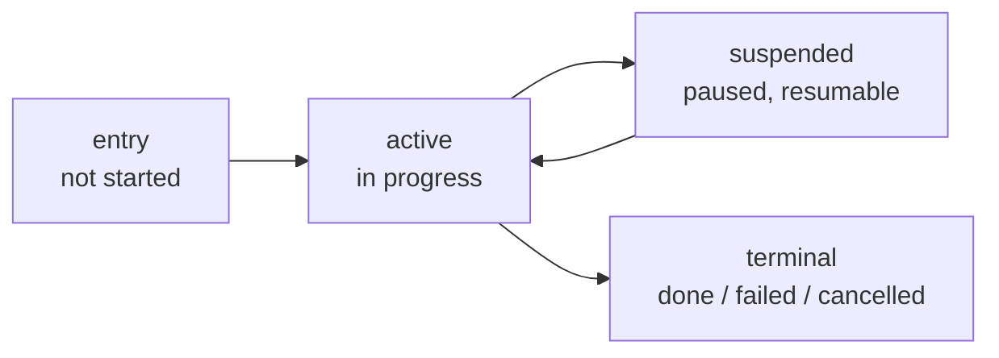
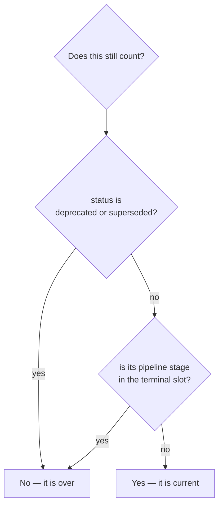

# State, lifecycle and pipelines

This is the **target model** for how anything in the graph that has a state says where it is. It states what we want, not what is built. It contains no migration, no changelog and no implementation plan — those are separate documents.

**Issue of record:** #11824 · **Supersedes the design of:** §4.3 Object status, §5 Point status, `goalState` (§4.3), pack `statuses`/`folds` (§9), pipeline stages.

---

## 1. The problem in one paragraph

Today "status" answers at least three unrelated questions at once. One word can mean *does this claim still count as a belief*, or *what state is this customer record in*, or *did this goal work out*. Because the word is shared, the meaning is not: the list of words lives in one place, and the rule for what "finished" means lives somewhere else — in hardcoded lists that only contain built-in words. There are **at least eight** such lists (`live.py`, `commit_ops.py`, `assembly.py`, `sdk.py`), four of them of sizes 1/5/4/2 and the rest differing from those in content. So anything with a word outside a given list is **treated as current by everything that reads that list**, which is the same as saying it never ends. Nine declarations across our packs use thirty words; one of them is in the built-in list.

---

## 2. The four questions, and who owns each

Everything that looked like "status" is one of these. Three get a field; visibility does not.

| question | what it really asks | owned by |
|---|---|---|
| **1. Lifecycle** | Is this a current commitment, or is it over — and if over, how did it end? | the `status` word — one closed write set of four, every kind except events (§8) |
| **2. Position** | Where is this in its process? | a **pipeline**: stages declared per kind |
| **3. Achievement** | Did the goal actually work out? | its own field (`goalState`), already separate and working |
| **4. Visibility** | Is this tucked out of the default view? | a **flag**, not a word — and out of scope until a surface needs it |

Questions 1 and 2 are the two axes. They are separate because **they change for different reasons**: lifecycle changes when a thing is promoted, replaced or retired — rarely, and by decision. Position changes as work moves — often, and sometimes automatically from events. Mixing them means a routine progress update can silently retire a commitment.

Questions 3 and 4 are **not** lifecycle. Achievement is already its own axis (a goal can be `live` *and* `unmet` — both true at once, which is the proof they are different questions). Visibility is a property of a view, not of the thing.

---

## 3. The lifecycle word

Every kind **except events** — claims, entities and sources — uses **one** closed set of four words. Events are the one exclusion, and §8 says why: an event is a dated fact, not a commitment, so it has no lifecycle to be in.

| word | means | can move to |
|---|---|---|
| `draft` | created, not yet a commitment. Present in the graph; not counted as in force. | `live` — or straight to `deprecated`/`superseded`, because a draft can end before it was ever promoted (`sdk.py`'s `_ALLOWED_TRANSITIONS`, the #432 decision) |
| `live` | current: in force and counted. | `deprecated`, `superseded` |
| `deprecated` | ended, and **nothing replaced it**. Final. | — |
| `superseded` | ended because something **replaced** it. Final. The replacement is named. | — |

**The one rule that carries the meaning:** `superseded` names its successor. If nothing replaced it, the word is `deprecated`. That is the only difference between the two, and it is the rule every comparable system uses.

### 3.1 Verbs are not words

A *verb* is what someone does; a *word* is what the record then says. Several verbs land on the same word, and that is correct — it keeps the vocabulary small without losing distinctions in what happened.

| verb | resulting word |
|---|---|
| promote | `live` |
| retire, withdraw, archive, retract, reject, invalidate | `deprecated` |
| replace, supersede, correct | `superseded` (successor named) |

This is why the current five extra words are not needed — `retracted`, `outdated`, `archived`, `in_progress`, `completed`: each of them is a verb's name leaking into the state vocabulary. Keeping verbs separate from states means a new verb never grows the vocabulary. `deprecated` is the one word in the base set that is not a removal: it is already declared for Objects and Subjects and already read for legacy Points, so promoting it introduces no word. (A family's **read delta**, §6, may still *retain* one of these as a word its readers must treat as ended — what is removed is its standing as a **write** word a verb can produce.)

### 3.2 What is deliberately not a lifecycle word

| not a word | what it actually is | where it lives |
|---|---|---|
| "archived" | a visibility choice about what you look at | a flag, if and when a surface needs it. Retroactively filing a rejected thing must not erase *why* it ended |
| "in-progress", "completed" | position in a process | a pipeline stage |
| "outdated" | the past name of the Point "no longer counts" mechanism | the `deprecated`/`superseded` words above |
| "blocked", "paused", "waiting" | an interruption, not an ending | a stage in the `suspended` slot — and for a **goal**, `blocked` is also one of its `goalState` values. The two do not collide: the stage is read by its **slot**, never its name (§4.1) |
| "met", "unmet", "abandoned" | how the goal worked out | `goalState` |

---

## 4. The pipeline

A pipeline says where a thing is in a process. It is **not** a lifecycle: a stage says *how far along*, never *whether the commitment still stands*.

A pipeline is a short ordered list of **stages**. Each stage declares:

| field | means |
|---|---|
| `id` | a stable name for the stage |
| `label` | what a person sees |
| `order` | its place in the sequence |
| `slot` | which of four roles it plays — see below |
| `outcome` | for a terminal stage only: how it ended |

The **slot** is the field that carries the meaning, and it is the piece today's model is missing:

| slot | means | examples of the role |
|---|---|---|
| `entry` | not started yet | a backlog item before work begins |
| `active` | in progress | being worked on |
| `suspended` | paused but not ended — can resume | blocked, on hold, awaiting input |
| `terminal` | **ended**; the process is over | done, failed, cancelled, written off |

**A stage in a `terminal` slot is what makes a pipeline's ending real.** Without it, a list of stage names is decoration: nothing can tell that `done` means over.

### 4.1 Why the slot, and not "just mark done"

Because a stage's *name* is the most customisable thing in the system — a pack can call it `released`, `written-off`, `signed`, `shipped`. A **role** does not change when the name does. So the meaning lives in the slot and the name lives in the label, and a pack can rename everything without breaking a single reader.

### 4.2 Who declares a pipeline

A pack declares pipelines for its own kinds. A graph with no pack still works: core kinds have no pipeline, and their state is the lifecycle word alone.

This is what makes the model customisable without becoming a configuration language: **the shape is fixed (four slots, ordered stages, one outcome on a terminal stage); the contents are declared per kind.** A CRM funnel, a work item's flow and a goal's outcome are all the same shape with different stage names.

---

## 5. The data model

**Three state fields** — `status`, `pipelineStage` (with its `pipelineOutcome`), and `goalState` — **plus the successor bookkeeping that the `status` word obliges when it is `superseded`.** No others.

| field | lives on | values | written by |
|---|---|---|---|
| `status` | every kind **except events** | `draft` · `live` · `deprecated` · `superseded` | a verb (§3.1) |
| `supersededBy`, `supersededAt` | wherever **`status`** is `superseded` | the successor's identity + when | the replace verb, in the same write as `superseded` |
| `pipelineStage` | kinds whose pack declares a pipeline | a stage `id` from that kind's declaration | the stage-advance verb, or an event the pack folds onto the stage |
| `pipelineOutcome` | same | the `outcome` of the terminal stage reached | the same write that moves into a terminal stage |
| `goalState` | goals | `met` · `unmet` · `blocked` · `abandoned` · `active` · `guideline` · `superseded` | the goal's own writer (unchanged) |

`supersededBy`/`supersededAt` are not a fourth kind of state — they are what the `status` word obliges you to record. They bind to **`status`**, not to `goalState`: a goal whose `goalState` is `superseded` records its successor on its `status` (a goal is an Object, and the carriers are gated to Object and Subject — `sdk.py`'s `_LIFECYCLE_CARRIER_LABELS`), which is also what the reader rule in §6 consults. The three state fields are `status`, `pipelineStage` (with its `outcome`) and `goalState`.

`superseded` is the one word that carries the same meaning on two axes, and that is correct rather than a collision: on both, it means *replaced by a named successor*. What differs is **what** was replaced — a claim, or a commitment — and saying which is the axis's job. If the two ever come to mean different things, that is when one of them must be renamed.

`blocked` is one of the words that appears more than once, and it is not the `superseded` case: as a `goalState` value it is a *recorded fact about achievement*, while as a stage name it is only a label on a `suspended`-slot stage. `active` likewise names both a slot **role** and a `goalState` value. Neither collides, because **slot ids are their own namespace**: a reader resolves a stage by its slot (§4.1) and a goal's achievement by `goalState`, and nothing reads a stage's *name*. Only a **value on two axes** (`superseded`) needs the explanation above.

Every field is **optional**. A thing with no `status` reads as `live` — created and current is the ordinary case, and it must not require a write. A thing with no pipeline has no position, and that is not a defect.

---

## 6. The one rule every reader follows

This is the whole architecture in one decision. Anything that needs to know "does this still count" asks **one** question, from **two** sources of meaning:

- **Lifecycle** answers it, because `deprecated` and `superseded` are ends.
- **Position** answers it too, because a `terminal` slot is an end.
- Nothing else does. A stage in `active` or `suspended` is never an ending; a missing stage is never an ending.

There is **one** implementation of this rule, and every reader uses it: search, retrieval, ranking, belief, audit, export. Today at least eight different lists implement it with different contents, which is why a word can be dead to one reader and alive to another.

The rule reads the **base** set plus any **delta** the family declares — it is not one collapsed list. Two families legitimately answer different questions, and #11824 recorded the shape this model must keep: *"one base set plus named, declared deltas"*, because *"collapsing them would be a reopen"*. `commit_ops.py:61-65` says the same — *"Do not unify the two blindly: they answer different questions"* — and `assembly.py`'s resolver narrowing is the live example of a delta: it resolves a **wider** set on purpose (superseded/deprecated/archived Objects must resolve to render their own state), and its own comment warns that re-pointing it at the canonical set stops the current-state question firing. A delta is therefore **declared and named**, never a divergence discovered later.

A delta is a **read-side** declaration: which words a family's readers must treat as no longer current. It **never adds a lifecycle word** — the write vocabulary stays one closed set of four (§3), so a delta cannot mint a state no verb can produce.

---

## 7. What this model guarantees

| guarantee | why it follows |
|---|---|
| **A word means one thing.** | One closed lifecycle set of four is the only **write** vocabulary, plus a named **read** delta per family where one is genuinely needed (§6). The same word cannot be an ending in one family and a current state in another without that delta declaring it. |
| **Every ending is real.** | An ending is either a lifecycle word or a `terminal` slot — and both are declarations, not names a reader has to recognise. |
| **Customising names cannot break readers.** | Readers read slots and words, never stage names. |
| **Adding a domain does not touch the engine.** | A new domain is a declared pipeline, not new code. |
| **The vocabularies stay small.** | Four lifecycle words. Verbs do not grow them. A second question gets a second field, not a bigger list. |
| **Nothing is lost when a thing is filed away.** | Visibility is a flag, so the reason something ended survives it. |
| **A second axis is the answer to a second question.** | `goalState` already proves it: a goal is `live` and `unmet` at the same time, and neither field overwrites the other. |

---

## 8. Requirements this model must not break

These are recorded decisions, not preferences. The model above is designed to sit *inside* them.

| requirement | source | how this model respects it |
|---|---|---|
| **An event has no lifecycle.** An event is a dated fact; a later event does not rewrite an earlier one. | #11825 / #12108 | Events take no lifecycle word. If an event must be withdrawn, that is a claim about it, not a state on it. |
| **Achievement is its own axis.** Goal outcome is not promotion. | #7856 | `goalState` stays separate, with its own closed set, and nothing reconciles it into `status`. |
| **A pack owns its kind's words.** | #2729; *Foreclosed* in `EXTRACTOR-V4-ARCHITECTURE.md` ("pack lifecycles own their words") | Packs declare stages; the engine never imposes stage names. |
| **One base set, plus named declared deltas — never one collapsed set.** | #11824's contradiction test; `commit_ops.py:61-65` "Do not unify the two blindly: they answer different questions"; the `assembly.py` resolver narrowing; the Object/Point vocabulary divergence in #3308 / PR #6955 | The four words are the **base** and the only write vocabulary. A family that must answer a different question declares its delta explicitly and names it; a delta is never a quiet divergence, and never a list to be re-pointed at the base. |
| **The claim family's "no longer counts" flag is load-bearing.** | #2498 | The flag's *effect* is preserved as the `deprecated`/`superseded` words; the mechanism is not removed by fiat. |
| **What a reader hides is wider than what a writer may create.** | #2977 | Readers must still be able to treat a word as dead that no verb currently produces — the net stays wider than the door. |
| **A single shared list cannot cover pack words.** | #2729, and Foreclosed in `EXTRACTOR-V4-ARCHITECTURE.md` ("pack lifecycles own their words") | There is no shared *stage* list. Only the lifecycle **base** set is shared, and it is small enough to be closed. |
| **A word with no reader is not added.** | the withdrawal of `stale`, #11824 | This model introduces no new word and removes **five** — `retracted`, `outdated`, `archived`, `in_progress`, `completed` — leaving a base set of four. |

---

## 9. Out of scope

Deliberately absent, and each has its own document:

- **How we get from today to this.** Migration, backfill and re-stamping.
- **What the built-in default pipeline for each core kind is.** Worth a research pass on its own; the model does not depend on which stages we ship.
- **The implementation plan**, the code surfaces, and the test strategy.
- **Visibility/filing.** Named here because it must not become a status word; no surface needs it yet.
- **The deltas themselves.** §6 fixes the *shape* — one base set plus named, declared **read** deltas — but not each family's delta. Which delta a family needs, and what each contains, is part of #11824's ordered removal plan, not this document.

---

## 10. The model in one paragraph

Everything in the graph that has a lifecycle — everything **except events** (§8) — has **one** lifecycle word from a closed set of four, and optionally a **position** in a pipeline its kind declares. A family may declare a **read** delta over which words its readers treat as ended (§6), but never a new write word. The lifecycle word says whether the commitment still stands; the pipeline stage says how far along it is; a goal's outcome is a third field of its own; visibility is a flag and never a word. Every reader asks one question — *does this still count?* — and answers it from exactly two places: the lifecycle word, and whether the stage sits in a `terminal` slot. Words declare their meaning where they are declared, so a pack can invent any stage names it likes and nothing that reads the graph has to learn them.
