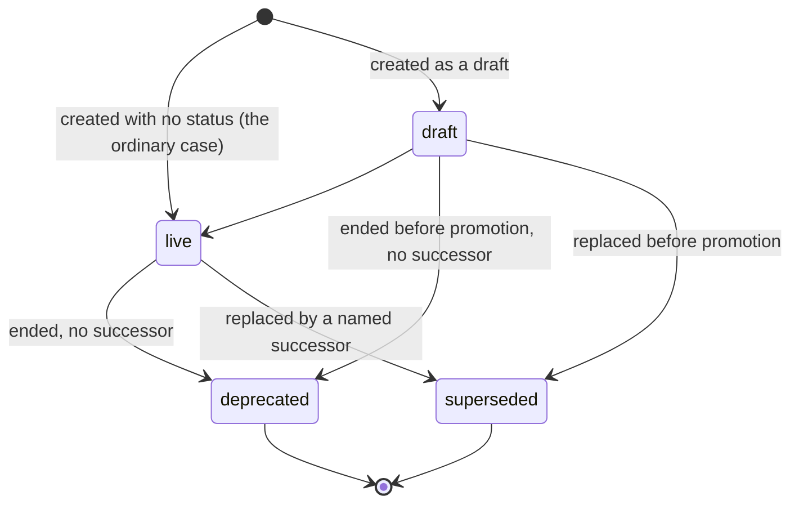
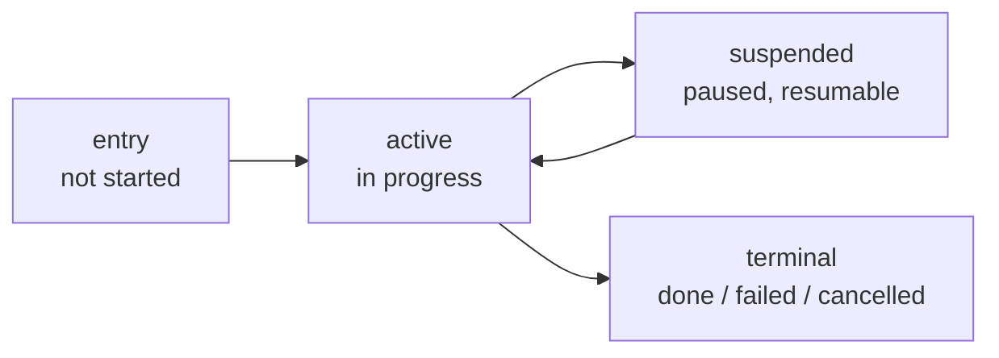

# State, lifecycle and pipelines

This is the **target model** for how anything in the graph that has a state says where it is. It states what we want, not what is built. It contains no migration, no changelog and no implementation plan — those are separate documents.

**Issue of record:** #11824 · **Supersedes the design of:** the **status / lifecycle vocabulary** only — §4.2 Subject status, §4.3 Object status, §5 Point status, `goalState` (§4.3), and pack `statuses`/`folds` (§9). The **pipeline** slot model is **not** superseded: it is already shipped (`#2792`, `tortoise/pipeline.py`) and §4 restates it rather than redefining it.

**What is actually new here** is narrow, and worth stating plainly so a reader does not rebuild what exists — most of this machinery already ships. `tortoise/live.py` is the **single shared predicate** (#2901 / #2422): `is_terminal_status` and the Cypher twin `_terminal_excluded`, declared once and imported by the readers that skip non-current rows across `ranking`, `ep`, `sdk`, `why`, `projection`, `entity_identity`, `search_engine` and others, under its own recorded rule *"NO reader re-spells the predicate"* (the module deliberately states **no census**, because "the census grows with every reader … each number was stale within a release"). That module also already carries the **base-set-plus-delta seam**: `_terminal_excluded(clause, excluded=…)` takes a family's vocabulary (defaulting to the Point one) and `include_outdated_flag=` toggles the legacy conjunct for the Object family (#3301).

Adoption is not universal, and the exception is the point: `tortoise/mcp_server.py`'s tag arm hand-writes `r.get("status") != "retracted"`, so a default tag read **still serves superseded/archived/outdated/deprecated rows** — a gap the module's own docstring records and **#12502** tracks. That is this model's defect, live. So what is genuinely new is (a) one **four-word lifecycle** vocabulary for every kind except events, with `archived` retired and the successorless case moved onto `deprecated`; and (b) exactly **one new input** to the existing predicate — it does not read the pipeline's `terminal` slot, and it must.

> **OVERRIDES:** four recorded positions this model deliberately reverses, all named here so the departure is findable rather than read as history — (1) `docs/ONTOLOGY.md` §4.3 (`:449`, owner-approved text under that file's CRITICAL RULE at `:41`): *"a retirement with no successor is `archived`"*; (2) the same clause's *"pack-declared kinds validate against their own declared words"* as applied to the **status** vocabulary — `commit_ops.py:114-122` records that a single shared status set was **foreclosed** because `packs/venture` exercises its own words, and this model answers that by moving those words onto the position axis rather than by widening the status list (a pack still validates against its own declaration — the declaration changes axis, it is not dropped); (3) the extractor's recorded removal-from-recall target (`EXTRACTOR-V4-ARCHITECTURE.md:1084`, 2026-10-26: a journaled `restatus` to **`archived`**); and (4) `archived` in `SUBJECT_STATUS_VALUES` (`commit_ops.py:123-124`). What replaces them: a thing with no successor ends by `deprecated`, and filing-away becomes a visibility **flag**. The reason is the collision §2 exists to remove — a word that means both *ended* and *hidden from a view*. **These are reversals of owner-approved text, so PR #12895's approval by the owner is the ruling**; until it is given, the recorded positions stand.

---

## 1. The problem in one paragraph

Today "status" answers at least three unrelated questions at once. One word can mean *does this claim still count as a belief*, or *what state is this customer record in*, or *did this goal work out*. Because the word is shared, the meaning is not: the **words** are declared per-kind and per-pack — which is correct, and a single shared list is foreclosed (`commit_ops.py`: "a shared `OBJECT_STATUS_VALUES` would refuse real words and narrow the door") — while the **rule** for what "finished" means exists in one canonical form for Points (`live.py`, #2901) and, outside that family, as eight or more sets of two different kinds: some are **legitimate declared deltas** (the Object and Subject vocabularies, and the resolver's deliberate narrowing, which §6 keeps), and some are **undisciplined re-statements that serve a dead row as current** — the `mcp_server.py` tag arm's bare `!= "retracted"` is the live example (#12502). Four of the sets are of sizes 1/5/4/2 and the rest differ from those in content. Where a reader does not import the canonical predicate and does not declare a delta, anything with a word outside its own list is **treated as current**, which is the same as saying it never ends. Nine declarations across our packs use thirty words; one of them is in the built-in list.

---

## 2. The four questions, and who owns each

Everything that looked like "status" is one of these. Three get a field; visibility does not.

| question | what it really asks | owned by |
|---|---|---|
| **1. Lifecycle** | Is this a current commitment, or is it over — and if over, how did it end? | the `status` word — one closed write set of four, every kind except events (§8) |
| **2. Position** | Where is this in its process? | a **pipeline**: stages declared per kind |
| **3. Achievement** | Did the goal actually work out? | its own field (`goalState`), already separate and working |
| **4. Visibility** | Is this tucked out of the default view? | a **flag**, not a word — and out of scope until a surface needs it |

Questions 1 and 2 are the two axes. They are separate because **they change for different reasons**: lifecycle changes when a thing is promoted, replaced or retired — rarely, and by decision. Position changes as work moves — often, and sometimes automatically from events. Mixing them means a routine progress update can silently retire a commitment.

Questions 3 and 4 are **not** lifecycle. Achievement is already its own axis (a goal can be `live` *and* `unmet` — both true at once, which is the proof they are different questions). Visibility is a property of a view, not of the thing.

---

## 3. The lifecycle word

Every kind **except events** — claims, entities and sources — carries **one** lifecycle word from a closed set of four. Events are the one exclusion, and §8 says why: an event is a dated fact, not a commitment, so it has no lifecycle to be in.

**A pack's own words are not refused by this — they move axis.** A pack declares its words as that kind's **pipeline stages** (§4.2), each carrying a slot, so `prospective`, `invested`, `written-off` become stages of a funnel and the kind's `status` still carries one of the four. This is the one place the model deliberately changes a recorded constraint: `commit_ops.py:116-122` records that a shared status vocabulary was **foreclosed** because `packs/venture` exercises its own words, and the answer here is not a wider status list but the axis the words actually belong to. A pack still validates against its own declaration — the declaration just has a shape now (see the `OVERRIDES` line above).

| word | means | can move to |
|---|---|---|
| `draft` | created, not yet a commitment. Present in the graph; not counted as in force. | `live` — or straight to `deprecated`/`superseded`, because a draft can end before it was ever promoted (`sdk.py`'s `_ALLOWED_TRANSITIONS`, the #432 decision) |
| `live` | current: in force and counted. | `deprecated`, `superseded` |
| `deprecated` | ended, and **nothing replaced it**. Final. | — |
| `superseded` | ended because something **replaced** it. Final. The replacement is named. | — |

**The one rule that carries the meaning:** `superseded` names its successor. If nothing replaced it, the word is `deprecated`. That is the only difference between the two, and it is the rule every comparable system uses.

### 3.1 Verbs are not words

A *verb* is what someone does; a *word* is what the record then says. Several verbs land on the same word, and that is correct — it keeps the vocabulary small without losing distinctions in what happened.

| verb | resulting word |
|---|---|
| promote | `live` |
| retire, withdraw, retract, reject, invalidate | `deprecated` |
| replace, supersede, correct | `superseded` (successor named) |

This is why the current five extra words are not needed — `retracted`, `outdated`, `archived`, `in_progress`, `completed`: each of them is a verb's name leaking into the state vocabulary. Keeping verbs separate from states means a new verb never grows the vocabulary. `deprecated` is the one word in the base set that is not a removal: it is already declared for Objects and Subjects and already read for legacy Points, so promoting it introduces no word. (A family's **read delta**, §6, may still *retain* one of these as a word its readers must treat as ended — what is removed is its standing as a **write** word a verb can produce.)

### 3.2 What is deliberately not a lifecycle word

| not a word | what it actually is | where it lives |
|---|---|---|
| "archived" | a visibility choice about what you look at | a flag, if and when a surface needs it. Retroactively filing a rejected thing must not erase *why* it ended |
| "in-progress", "completed" | position in a process | a pipeline stage |
| "outdated" | the past name of the Point "no longer counts" mechanism | the `deprecated`/`superseded` words above |
| "blocked", "paused", "waiting" | an interruption, not an ending | a stage in the `suspended` slot — and for a **goal**, `blocked` is also one of its `goalState` values. The two do not collide: the stage is read by its **slot**, never its name (§4.1) |
| "met", "unmet", "abandoned" | how the **goal** worked out | `goalState` — which is meaningful only on `goal`/`target`/`strategy`/`plan`. On any other kind the word is progress, so it becomes a pipeline stage: `packs/venture`'s `condition` (`statuses: [unmet, met]`) is not a goal, and its words are stages |

---

## 4. The pipeline

A pipeline says where a thing is in a process. It is **not** a lifecycle: a stage in `entry`, `active` or `suspended` says *how far along*, never *whether the commitment still stands*. The one exception is the `terminal` slot, which is one of the two endings (§6) — and that is exactly why the slot exists rather than a stage name.

A pipeline is a short ordered list of **stages**. Each stage declares:

| field | means |
|---|---|
| `id` | a stable name for the stage |
| `label` | what a person sees |
| `order` | its place in the sequence |
| `slot` | which of four roles it plays — see below |
| `outcome` | for a terminal stage only: how it ended |

The **slot** is the field that carries the meaning — and **it is already shipped**, not proposed here: `tortoise/pipeline.py` (#2792, closed) declares `PIPELINE_SLOTS` and `PIPELINE_OUTCOMES`, validates both, and stores the current stage on the Object as `pipelineStageId` / `pipelineSlot` / `pipelineOutcome` / `pipelineStageSince` / `isClosed`, with a pack opting in through `kindDefs[<kind>].pipeline`. That module also states the separation this document depends on: *"`Object.status` keeps its existence-axis meaning (`live`/`superseded`); the pipeline stage is a separate property"*. This section therefore **restates the shipped shape rather than introducing it**, and cites the module so a reader does not rebuild it.

| slot | means | examples of the role |
|---|---|---|
| `entry` | not started yet | a backlog item before work begins |
| `active` | in progress | being worked on |
| `suspended` | paused but not ended — can resume | blocked, on hold, awaiting input |
| `terminal` | **ended**; the process is over | done, failed, cancelled, written off |

**A stage in a `terminal` slot is what makes a pipeline's ending real.** Without it, a list of stage names is decoration: nothing can tell that `done` means over.

### 4.1 Why the slot, and not "just mark done"

Because a stage's *name* is the most customisable thing in the system — a pack can call it `released`, `written-off`, `signed`, `shipped`. A **role** does not change when the name does. So the meaning lives in the slot and the name lives in the label, and a pack can rename everything without breaking a single reader.

### 4.2 Who declares a pipeline

A pack declares pipelines for its own kinds. A graph with no pack still works: a core kind has no pipeline **until a default is declared for it**, and its state is the lifecycle word alone.

This is what makes the model customisable without becoming a configuration language: **the shape is fixed (four slots, ordered stages, one outcome on a terminal stage); the contents are declared per kind** — which is exactly the two-tier split `tortoise/pipeline.py` already ships (canonical slots in core, tenant stages declared per graph). A CRM funnel, a work item's flow and a goal's outcome are all the same shape with different stage names.

---

## 5. The data model

**Three state fields** — `status`, the pipeline stage (`pipelineStageId` + `pipelineSlot`, with `pipelineOutcome` and `isClosed`), and `goalState` — **plus the successor bookkeeping that the `status` word obliges when it is `superseded`.** No others, and the pipeline field names are the shipped ones (#2792) rather than new spellings.

| field | lives on | values | written by |
|---|---|---|---|
| `status` | every kind **except events** | `draft` · `live` · `deprecated` · `superseded` | a verb (§3.1) |
| `supersededBy`, `supersededAt` | **Object and Subject only** — a Point names its successor by the `CORRECTS` edge, not by a property (`ONTOLOGY.md` §4.7: a Point carries `status='superseded'` and has no `supersededAt`) | the successor's identity + when | the replace verb, in the same write as `superseded` |
| `pipelineStageId` (+ `pipelineSlot`) | kinds whose pack declares a pipeline | a stage `id` from that kind's declaration | the stage-advance verb, or an event the pack folds onto the stage |
| `pipelineOutcome`, `isClosed` | same | the `outcome` of the terminal stage reached | the same write that moves into a terminal stage |
| `goalState` | goals | `met` · `unmet` · `blocked` · `abandoned` · `active` · `guideline` · `superseded` | the goal's own writer (unchanged) |

`supersededBy`/`supersededAt` are not a fourth kind of state — they are what the `status` word obliges you to record. They bind to **`status`**, not to `goalState`, because a goal is an Object and the carriers are gated to Object and Subject (`sdk.py`'s `_LIFECYCLE_CARRIER_LABELS`) — and `sdk.py` refuses a lifecycle carrier on a node whose **resulting** status is not `superseded` — the status it reads is the one supplied in the write, else the one already stored, so adding a stamp to an already-superseded node stays writable. The three state fields are `status`, the pipeline stage (`pipelineStageId` with `pipelineSlot`, plus `pipelineOutcome`/`isClosed`) and `goalState`.

**A goal that retires crosses both axes in one write.** `superseded` and `abandoned` are the two `goalState` words that mean the goal is no longer a pursued commitment (`derived_invalidation.RETIRED_GOAL_STATES`); the other five describe a *live* commitment. So a goal that retires also sets `status` in the same write — `superseded`, naming its successor, or `deprecated` where there is none. The axes stay independent for the other five words, and the coupling runs in one direction only: `goalState` never reads `status` back.

`superseded` is the one word that carries the same meaning on two axes, and that is correct rather than a collision: on both, it means *replaced by a named successor*. What differs is **what** was replaced — a claim, or a commitment — and saying which is the axis's job. If the two ever come to mean different things, that is when one of them must be renamed.

`blocked` and `active` are values that appear on two axes as well, and neither is the `superseded` case. `active` names a **slot role** (§4) and a `goalState` value; `blocked` is only ever a stage *name* and a `goalState` value. They cannot collide because **the slot field is its own namespace**, distinct from stage `id`, `label` and `order`: a reader resolves a stage by its `slot` (§4.1), never by any of the stage's names. `superseded` is the only word whose *meaning* has to be reconciled across two **fields a reader reads**, which is why it is the one that needs the explanation above.

Every field is **optional**. A thing with no `status` reads as `live` — created and current is the ordinary case, and it must not require a write. A thing with no pipeline has no position, and that is not a defect.

---

## 6. The one rule every reader follows

This is the whole architecture in one decision. Anything that needs to know whether a thing still counts as current asks **one** question, from **two** sources of meaning:

- **Lifecycle** answers it, because `deprecated` and `superseded` are ends.
- **Position** answers it too, because a `terminal` slot is an end.
- Nothing else does. A stage in `active` or `suspended` is never an ending; a missing stage is never an ending.

The question is **"is this still served as current?"**, deliberately not "is this counted as a belief?". Those are different, and `draft` is the difference: it is **current** (not retired — it is served, and a reader renders it) yet **not in force** (inert for belief computation, excluded from EP factor extraction). A reader that needs the second answer asks a second question; no reader is allowed to answer "not current" as a shorthand for "not in force", because that is exactly how a word becomes dead to one surface and alive to another.

**The implementation already exists. What does not is the second input.** `tortoise/live.py` declares the one shared predicate (#2901 / #2422) — `is_terminal_status` / `_terminal_excluded` — and its own header records the rule that keeps it one: *"NO reader re-spells the predicate … Do NOT re-declare a status set at a call site. A hand-written subset is how `outdated` was omitted from three reader filters … and a superseded/outdated claim was then served as the CURRENT statement."* It already takes the family as an input rather than a second implementation: `_terminal_excluded(excluded=…)` defaults to the Point vocabulary and the Object read surfaces pass their own (#3301), which is the delta seam in practice.

So the work is not to build a shared reader — that was built, and it is imported across the read surfaces (minus the one arm named above, #12502). The work is that **the predicate reads two sources and must read three**: it answers from the terminal-status vocabulary **and** the legacy `outdated` flag (`_terminal_excluded` builds `(status_part AND coalesce(flag, false) = false)`, with `include_outdated_flag=False` for the Object family), while a thing ended by a `terminal` **slot** is invisible to it. Extending that one function to read the slot as well is the whole change, and it is small *because* the shared implementation and its delta seam already exist — the same seam the `outdated` flag already rides.

The rule reads the **base** set plus any **delta** the family declares — it is not one collapsed list. Two families legitimately answer different questions, and #11824 recorded the shape this model must keep: *"one base set plus named, declared deltas"*, because *"collapsing them would be a reopen"*. `commit_ops.py:61-65` says the same — *"Do not unify the two blindly: they answer different questions"* — and `assembly.py`'s resolver narrowing is the live example: it declares a **narrower** set than the read-surface vocabulary on purpose, so that a superseded/deprecated/archived Object still **resolves** to render its own state, and its own comment warns that re-pointing it at the canonical set is what stops the current-state question firing. A delta is therefore **declared and named**, never a divergence discovered later.

A delta is a **read-side** declaration: the set of words a family's readers treat as **ended**. It may **widen** the base (adding a legacy word its stored data still contains) or **narrow** it (withholding a base ending from a particular reader, as the resolver does) — the direction is part of the declaration, not an accident of it. It **never adds a write word**: the write vocabulary stays one closed set of four (§3), so a delta cannot mint a state no verb can produce.

---

## 7. What this model guarantees

| guarantee | why it follows |
|---|---|
| **A word means one thing.** | One closed lifecycle set of four is the only **write** vocabulary, plus a named **read** delta per family where one is genuinely needed (§6). The same word cannot be an ending in one family and a current state in another without that delta declaring it. |
| **Every ending is real.** | An ending is either a lifecycle word or a `terminal` slot — and both are declarations, not names a reader has to recognise. |
| **Customising names cannot break readers.** | Readers read slots and words, never stage names. |
| **Adding a domain does not touch the engine.** | A new domain is a declared pipeline, not new code. |
| **The vocabularies stay small.** | Four lifecycle words. Verbs do not grow them. A second question gets a second field, not a bigger list. |
| **Nothing is lost when a thing is filed away.** | Visibility is a flag, so the reason something ended survives it. |
| **A second axis is the answer to a second question.** | `goalState` already proves it: a goal is `live` and `unmet` at the same time, and neither field overwrites the other. |

---

## 8. Requirements this model must not break

These are recorded decisions, not preferences. The model above is designed to sit *inside* them.

| requirement | source | how this model respects it |
|---|---|---|
| **An event has no lifecycle.** An event is a dated fact; a later event does not rewrite an earlier one. | #11825 / #12108 | Events take no lifecycle word. If an event must be withdrawn, that is a claim about it, not a state on it. |
| **Achievement is its own axis.** Goal outcome is not promotion. | #7856 | `goalState` keeps its own closed set; it is never derived from `status`. The coupling runs one way only, for the two retirement words — a goal that retires also sets `status` in the same write (§5) — because the successor carriers and the reader rule are bound to `status`. |
| **A pack owns its kind's words.** | #2729; *Foreclosed* in `EXTRACTOR-V4-ARCHITECTURE.md` ("pack lifecycles own their words") | Packs declare stages; the engine never imposes stage names. A pack's declared status words are not refused — they become that kind's stage names (§4.2), so the declaration is preserved and only its axis changes. |
| **One base set, plus named declared deltas — never one collapsed set.** | #11824's contradiction test; `commit_ops.py:61-65` "Do not unify the two blindly: they answer different questions"; the `assembly.py` resolver narrowing; the Object/Point vocabulary divergence in #3308 / PR #6955 | The four words are the **base** and the only write vocabulary. A family that must answer a different question declares its delta explicitly and names it; a delta is never a quiet divergence, and never a list to be re-pointed at the base. |
| **The claim family's "no longer counts" flag is load-bearing.** | #2498 | The flag's *effect* is preserved as the `deprecated`/`superseded` words; the mechanism is not removed by fiat. |
| **What a reader hides is wider than what a writer may create.** | #2977 | Readers must still be able to treat a word as dead that no verb currently produces — the net stays wider than the door. |
| **A single shared list cannot cover pack words.** | #2729, and Foreclosed in `EXTRACTOR-V4-ARCHITECTURE.md` ("pack lifecycles own their words") | The shared **stage** list is the shipped four-slot vocabulary (#2792), and it covers only *roles*, never names — so no pack word is refused. Pack words live on the position axis. |
| **A word with no reader is not added.** | the withdrawal of `stale`, #11824 | This model introduces no new word and removes **five** — `retracted`, `outdated`, `archived`, `in_progress`, `completed` — leaving a base set of four. |

---

## 9. Out of scope

Deliberately absent, and each has its own document:

- **How we get from today to this.** Migration, backfill and re-stamping.
- **Which stages each core kind's default pipeline ships with.** The model does not depend on those names; it depends only on the *shape* (§4.2), so this is a declaration to fill in, not a design question this document settles.
- **The implementation plan**, the code surfaces, and the test strategy.
- **Visibility/filing.** Named here because it must not become a status word; no surface needs it yet.
- **The deltas themselves.** §6 fixes the *shape* — one base set plus named, declared **read** deltas — but not each family's delta. Which delta a family needs, and what each contains, is part of #11824's ordered removal plan, not this document.

---

## 10. The model in one paragraph

Everything in the graph that has a lifecycle — everything **except events** (§8) — has **one** lifecycle word from a closed set of four, and optionally a **position** in a pipeline its kind declares. A family may declare a **read** delta over which words its readers treat as ended (§6), but never a new write word. The lifecycle word says whether the commitment still stands; a pipeline stage says how far along it is, **except** that a stage in the `terminal` slot is itself an ending. A goal's outcome is a third field of its own; visibility is a flag and never a word. Every reader asks one question — *is this still served as current?* — and answers it from exactly two places: the lifecycle word, and whether the stage sits in a `terminal` slot. Words declare their meaning where they are declared, so a pack can invent any stage names it likes and nothing that reads the graph has to learn them.
